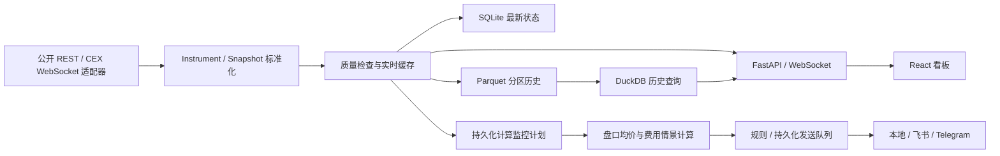

# 架构与数据流

## 所有权

- `models.py` 定义跨模块契约；时间统一 UTC 毫秒，费率为小数，原始报价币保留。
- `adapters/cex.py` 封装公开 CCXT 服务；区域和产品端点通过市场 ID 区分。
- `adapters/streaming.py` 提供受支持 CEX 的公开 ticker 流，失败时退回 REST；按市场更新订阅并清理旧连接。REST/WS 合并以字段事件与本地接收时间比较，不允许较慢响应回退新价格，也不允许新成交价刷新保留的旧买卖盘年龄。
- `adapters/dex.py` 封装原生公共 API、部分 CCXT 永续与明确标识的聚合池发现。
- `collector.py` 管理发现、关注列表、质量检查、独立平台循环、超时/指数退避、重试和缓存。只有完整目录发现才能将消失市场标记 inactive；旧身份与历史保留。
- `storage.py` 通过 SQLite 持久化配置、映射审计和最新快照；Parquet 使用原子文件替换，DuckDB 参数化查询和保留期清理。
- `strategies.py` 纯输入计算，原始盘口和费用来源保留在明细中；保存样本与按接收/操作延迟进行的回放独立于全局行情。
- `monitors.py` 持久化用户定义的计算计划，重新拉取真实深度；不修改旧报价的时间，不自动假设新 FX 或 DEX 路线报价。
- `notifications.py` 保存规则、冷却、触发状态、通知与每渠道发送任务。凭证不进入 API/数据库/日志。

## 运行边界

采集、历史写入、计算和通知可分别关闭。通知关闭暂停新任务与队列派发；已在网络传输中的请求可能完成。支持的 CEX 优先使用行情源 WS 更新价格，REST 补充资金费/OI并作为降级；DEX 当前为 REST。前端 WebSocket 推送频率独立于源更新频率，界面 WS 与交易所 WS 分开显示。

轻量采集当前限制在关注资产，市场目录每六小时刷新；全目录广覆盖 ticker 分层订阅、原始流按需录制尚待扩展。浏览器或本地应用通过 on-demand orderbook 请求获取深度。历史不包含未接收的事件；没有伪造的数据补全。

未知费用/周期/可执行深度、过期字段、错币种和未确认身份会阻止完整收益结果。非订单簿协议的指示价格不会作为可成交价格。聚合器发现保留底层池身份和来源；直接 RPC 报价与完整区块状态采集仍需相应实现和外部条件。
